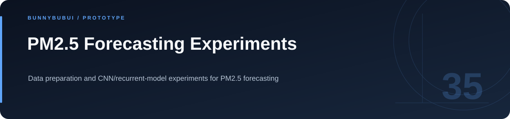
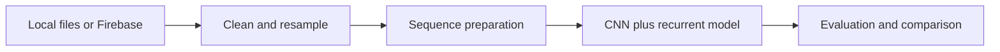

<p align="center">
  
</p>

<h1 align="center">PM2.5 Forecasting Experiments</h1>

<p align="center">Data preparation and CNN/recurrent-model experiments for PM2.5 forecasting</p>

<p align="center">
       
</p>

<p align="center"><a href="#overview">ภาพรวม</a> · <a href="#features">ความสามารถ</a> · <a href="#start">เริ่มใช้งาน</a> · <a href="#structure">โครงสร้าง</a> · <a href="#validation">ตรวจสอบงาน</a></p>

<a id="overview"></a>

## ภาพรวม

ชุดทดลองวิเคราะห์และพยากรณ์ PM2.5 ครอบคลุมการเตรียมข้อมูล การฝึกโมเดล CNN ร่วมกับ RNN/LSTM/GRU และการประเมินผลด้วย Python

<a id="features"></a>

## ความสามารถที่มีใน source

| ส่วนงาน | รายละเอียด | อ้างอิง |
|---|---|---|
| **Data preparation** | ทำความสะอาดและสร้าง sequence ข้อมูล | [ดู source](src/model/hooks/usePreprocessing.py) |
| **Model training** | เลือก RNN/LSTM/GRU ร่วมกับ Conv1D | [ดู source](src/model/hooks/useTrainModel.py) |
| **Evaluation** | ทดสอบและเปรียบเทียบโมเดล | [ดู source](src/model/ModelEvaluator.py) |
| **Data sources** | อ่านไฟล์ในเครื่องหรือเชื่อม Firebase | [ดู source](src/model/hooks/useFirebase.py) |

### เส้นทางการทำงาน



<a id="start"></a>

## เริ่มต้นใช้งาน

**สิ่งที่ต้องมี:** Python และ environment ที่ติดตั้ง TensorFlow, pandas, NumPy, scikit-learn, matplotlib, joblib และ firebase-admin

```sh
python -m venv .venv
# Activate .venv, then install the libraries used by the scripts.
cd src/model
python TrainModel.py
# After model artifacts exist:
python TestModel.py
```

เลือกโมเดลและแหล่งข้อมูลใน `src/model/config/Config.py` กำหนด `BOOKGIT_DATA_DIR`/`BOOKGIT_OUTPUT_DIR` เฉพาะเมื่อต้องการ override; ไฟล์ `.env.example` เป็นรายการอ้างอิง ไม่ได้ถูกโหลดอัตโนมัติ

<a id="configuration"></a>

## การตั้งค่า

ตัวอย่างค่าตั้งค่าอยู่ในไฟล์ต่อไปนี้ คัดลอกไปยังชื่อไฟล์ local ที่โปรเจกต์อ่านและกำหนดค่าของเครื่องที่ใช้

| ไฟล์ตัวอย่าง | ตัวแปรสำคัญ |
|---|---|
| [.env.example](.env.example) | `GOOGLE_APPLICATION_CREDENTIALS`, `FIREBASE_DATABASE_URL`, `BOOKGIT_DATA_DIR`, `BOOKGIT_OUTPUT_DIR` |

<a id="structure"></a>

## โครงสร้างที่ควรเริ่มอ่าน

| ตำแหน่ง | หน้าที่ |
|---|---|
| [src/](src) | source ของแอป |

<a id="validation"></a>

## คำสั่งและผลตรวจ

repository นี้ไม่ได้กำหนดชุด automated tests สำหรับทุก flow; ตรวจผลจาก entry point และข้อมูลสาธิตที่เกี่ยวข้อง

<a id="scope"></a>

## ขอบเขตของงาน

รายงานคุณภาพโมเดลควรแนบชุดข้อมูล วิธีแบ่งข้อมูล และผลประเมินที่ทำซ้ำได้

<a id="reading"></a>

## อ่านต่อ

- [บันทึกการเตรียม source](docs/CLEANUP.md)


---

<p align="center"><a href="https://github.com/BunnyBubui">BunnyBubui</a> · <a href="https://github.com/BunnyBubui/test">Software Portfolio</a></p>
